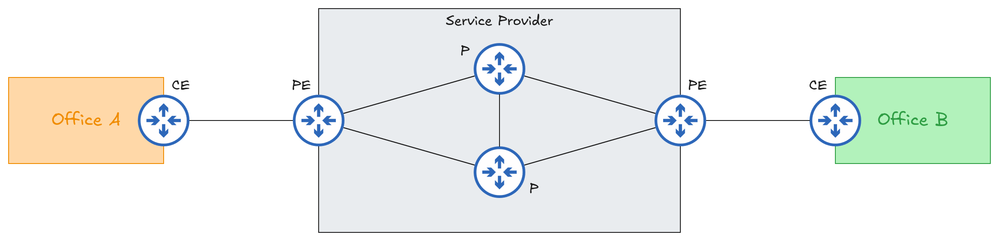

# 1.9 WAN Architectures
## Introduction
A **wide area network (WAN)** is a network that spans a large geographic area and connects geographically separated LANs.

**VPNs (Virtual Private Networks)** can be used to establish private WAN connections over public networks such as the Internet.
## Traditional WAN Technologies
### Leased Lines
A leased line is a dedicated telecommunications connection rented from a service provider to connect two locations over a private, fixed-capacity link.
- Leased lines commonly use **serial connections**.
- There are various standards that provide different speeds and different standards are available in different countries.
- Due to the higher costs, longer installation times, and lower speeds of leased lines, Ethernet WAN technologies are becoming more popular.
### MPLS (Multiprotocol Label Switching)
MPLS is a routing technique used by service providers and enterprises to forward data across a network **using short labels rather than network addresses**.
- Similar to the Internet, service providers’ MPLS networks are shared infrastructure because many customer enterprises connect to and share the same infrastructure to make WAN connections.
- The label switching mechanism in MPLS allows VPNs to be created over the MPLS infrastructure using labels.
	- These labels separate different customers' traffic as it travels over the shared infrastructure, ensuring that it remains isolated from other customers' traffic.
- **CE (Customer Edge)** router is located at the customer's site and connects the customer's LAN to the service provider's network.
	- CE routers do not use MPLS, it is only used by PE and P routers.
	- When using a **Layer 3 MPLS VPN**, CE and PE routers peer using BGP, OSPF or static routing.
	- When using a **Layer 2 MPLS VPN**, CE and PE routers do not form peerings.
		- In effect, it is like the two CE routers are directly connected. Their WAN interfaces will be in the same subnet.
		- If a routing protocol is used, two CE routers will peer directly with each other.
		- The entire service provider network acts like a large switch between two CE routers.
- **PE (Provider Edge)** router is located at the boundary between the customer's network and the service provider's MPLS network.
	- When PE routers receive frames from CE routers, they add labels to the packets.
	- These labels are used to make forwarding decisions within the service provider's network instead of destination IP addresses.
- **P (Provider Core)** router is located inside the service provider's network, between PE routers.
	- Forwards MPLS packets using labels.
- Many different technologies can be used to connect to a service provider's MPLS network for WAN services, such as fiber-optic Ethernet, 4G or 5G wireless, CATV (Cable Televison) and serial connections.

## Internet Access Technologies
### DSL (Digital Subscriber Line)
DSL provides Internet access over telephone lines.
- A DSL modem (modulator-demodulator) is required to convert data into a format suitable for transmission over telephone lines.
	- The modem may be a separate device or integrated into the home router.
- DSL is commonly used to provide Internet connectivity to homes and small businesses.
### Cable Internet
Cable internet provides Internet access over CATV (Cable Television) lines used for TV services.
- A cable modem is required to convert data into a format suitable for transmission over CATV cables.
	- The modem may be a separate device or integrated into the home router.
## Redundant Internet Connections
**Single-Homed**: A network connects to **one ISP using one connection**.

**Dual-Homed**:  A network connects to **the same ISP using two separate connections**.

**Multi-Homed**: A network connects to **two or more ISPs**.

**Dual Multi-Homed**: A network connects to **two or more ISPs, with redundant connections to each ISP**.

## Internet VPNs
An Internet VPN (Virtual Private Network) creates an encrypted logical connection over a public network, allowing secure communication.
### Site-to-Site VPNs (IPsec)
A site-to-site VPN securely connects two or more separate networks over a public network, usually the Internet.
- A **VPN tunnel** is created between the two devices by encapsulating the original IP packet with a VPN header and a new IP header.
	- When **IPsec** is used, the original packet is encrypted before being encapsulated with the new headers.
- In a site-to-site VPN, a tunnel is established only between two tunnel endpoints (e.g., the two routers connected to the Internet).
	- Other devices at each site do not need to establish their own VPN tunnels. They can send unencrypted data to their site's router, which encrypts it and forwards it through the tunnel.
- There are some limitations to standart IPsec:
	- **IPsec does not support broadcast or multicast traffic**, only unicast traffic. This means routing protocols such as OSPF cannot operate directly over IPsec tunnels because they rely on multicast traffic.
		- This can be solved with **GRE over IPsec**.
	- Configuring a full mesh of tunnels between multiple sites is labor-intensive.
		- This can be solved with **Cisco’s DMVPN**.

The packet is processed as follows:
1. The sending device encrypts the original packet using an encryption key.
2. The sending device encapsulates the encrypted packet with a VPN header and a new IP header.
3. The sending device transmits the encapsulated packet to the device on the other side of the tunnel.
4. The receiving device decrypts the packet to recover the original packet and then forwards it to its destination.

.png)
#### GRE over IPsec
GRE over IPsec is a VPN design that combines **GRE (Generic Routing Encapsulation)** and **IPsec (Internet Protocol Security)**.
- GRE creates tunnels similar to IPsec tunnels. However, it does not encrypt the original packet and is therefore not secure on its own.
- GRE can encapsulate a wide variety of Layer 3 protocols, as well as broadcast and multicast traffic.
- GRE over IPsec combines the flexibility of GRE with the security of IPsec.
	- The original packet is encapsulated with a GRE header and a new IP header. The resulting GRE packet is then encrypted and encapsulated with an IPsec header and another IP header.

#### DMVPN (Dynamic Multipoint VPN)
DMVPN is a Cisco-developed solution that allows routers to dynamically establish a full mesh of IPsec tunnels without requiring manual configuration of each tunnel.
- DMVPN provides the configuration simplicity of hub-and-spoke and the efficiency of direct spoke-to-spoke communication.
- After IPsec tunnels are configured between each spoke router and the hub, the hub provides each spoke with the information needed to establish IPsec tunnels with other spokes.
### Remote Access VPNs
A remote access VPN allows end devices to connect securely to a private network from a remote location over the Internet.
- Remote access VPNs typically use **TLS (Transport Layer Security)**.
- VPN client software is installed on end devices.
	- These devices establish secure tunnels to a company router or firewall acting as a TLS server.
	- This allows end devices to securely access a private network without being directly connected to it.
### Site-to-Site vs Remote Access VPN
|   Feature    |                          Site-to-Site VPN                          |                             Remote Access VPN                             |
| :----------: | :----------------------------------------------------------------: | :-----------------------------------------------------------------------: |
|   Protocol   |                         IPsec (Typically)                          |                                    TLS                                    |
| Connectivity |          Connects multiple devices across separate sites.          |       Connects individual end devices running VPN client software.        |
|   Use Case   | Establishes permanent connections between sites over the Internet. | Provides on-demand access to a private network from an untrusted network. |
