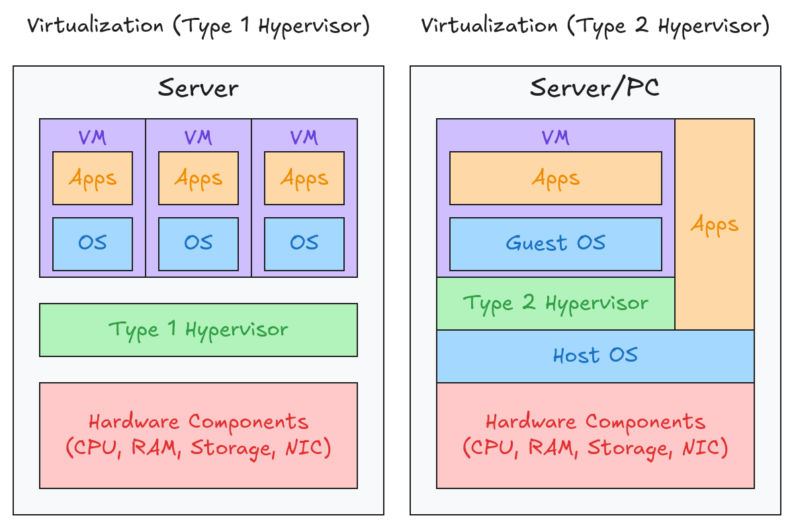
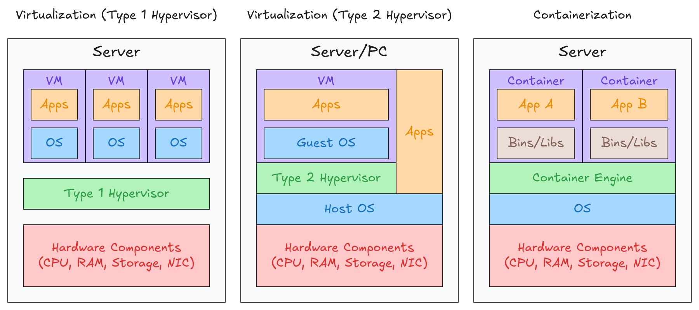

# 1.A Virtualization and Cloud
## Introduction
Before virtualization, there was a one-to-one relationship between a physical server and an operating system.
- Applications providing services such as web servers and email servers would run on that operating system.
- Each physical server would be dedicated to a specific service, such as a web server, email server or database server.
- This approach is inefficient for several reasons:
	- Each physical server is expensive and requires space, power and other resources.
	- The resources of each physical server, such as CPU, RAM, storage and NIC, are typically underutilized.
## Virtualization
Virtualization is a technology that allows one physical computer or server to run multiple virtual computers, called **virtual machines (VMs)**, using software to share its hardware resources.
- VMs connect to each other and the external network through a virtual switch running on the hypervisor.
- Like a physical switch, a virtual switch’s interfaces can operate as access or trunk ports and use VLANs to separate the VMs at Layer 2.
- Interfaces on the virtual switch connect to the server's physical NICs to enable communication with the external network.

Some benefits of virtualization include:
- **Cost Reduction**: Reduces the need to buy multiple physical servers.
- **Partitioning**: Allows multiple VMs to share a physical computer's resources.
- **Isolation**: Keeps VMs independent so that problems in one generally do not affect others.
- **Encapsulation**: Stores a VM as a set of files, making it easier to copy, move, back up and restore.
- **Hardware Independence**: Allows a VM to run on different compatible hardware with minimal changes.
- **Scalability**: Makes it easier to increase computing resources as needed.

### Type 1 Hypervisor
A type 1 hypervisor, also called a **native** or **bare-metal hypervisor**, runs directly on the physical hardware without needing a conventional host operating system.
- Another name for a hypervisor is **VMM (Virtual Machine Monitor)**.
- A hypervisor is used to manage and allocate the hardware resources to each VM.
### Type 2 Hypervisor
A type 2 hypervisor, also called a **hosted hypervisor**, is virtualization software that runs as an application on top of an existing operating system. It allows multiple virtual machines (VMs) to be created and run on a computer.
- The OS running directly on the hardware is called the **host OS**, and the OS running in a VM is called a **guest OS**.
- Although type 2 hypervisors are rarely used in data center environments, they are commonly used on personal devices.
## Cloud Computing
Traditional IT infrastructure deployments typically involved some combination of the following:
- **On-Premises**: All IT infrastructure is located on the company's own premises.
	- All equipment is purchased and owned by the company using it.
	- The company is responsible for providing the necessary space, power and cooling.
- **Colocation**: Data centers rent out space for customers to host their own infrastructure.
	- The data center provides the space, electricity and cooling.
	- The customer remains responsible for the servers, network devices and other equipment, even though they are located outside the customer's premises.

Cloud computing provides **on-demand network access to a shared pool of computing resources** that can be rapidly provisioned and released with minimal management effort.
### Five Essential Characteristics of Cloud Computing
**On-Demand Self-Service**: Consumers can provision computing resources as needed without requiring direct human interaction with the service provider.
- Resources can be requested whenever needed.
- Provisioning is performed by the consumer through a self-service interface.
- Direct communication with the provider is generally unnecessary.

**Broad Network Access**: Computing capabilities are accessible over the network through standard mechanisms that support various devices, such as smartphones, tablets, laptops and workstations.
- Services are accessible through network connections.
- Connections may use the public Internet or private networks, such as a WAN.

**Resource Pooling**: The provider's computing resources are shared among multiple consumers and dynamically allocated based on demand.
- Multiple customers share the provider's resource pool.
- Resources are allocated and reassigned as needed.
- Consumers may be able to specify a broader location, such as a country or region.

**Rapid Elasticity**: Computing resources can be rapidly scaled up or down, often automatically, to meet demand.
- Resources can be provisioned and released quickly.
- Available capacity may appear virtually unlimited to consumers.

**Measured Service**: Cloud systems automatically monitor, control and report resource usage, providing transparency for both providers and consumers.
- Resource usage is measured and monitored.
- Customers can review their consumption.
- Charges are often based on the amount of resources consumed, depending on the pricing model.
### Three Service Models of Cloud Computing
**Software as a Service (SaaS)**: Allows consumers to use the provider's applications through interfaces such as web browsers or APIs.
- The provider manages the underlying cloud infrastructure, operating systems, middleware and application software.
- Consumers can make limited user-specific application settings and configurations.
- SaaS allows consumers to **use ready-made software without managing the underlying infrastructure**.
- Amazon QuickSight, Google Workspace and Microsoft 365 are examples of SaaS.

**Platform as a Service (PaaS)**: Allows consumers to develop, deploy, and run applications using the provider's supported programming languages, libraries, and development tools.
- The provider manages the underlying cloud infrastructure, operating systems and platform runtime.
- Consumers manage the applications they develop and may control some application-hosting configurations.
- PaaS allows developers to **build and deploy applications without managing the underlying servers and operating systems**.
- AWS Elastic Beanstalk, Google App Engine, Azure App Service and are examples of PaaS.

**Infractructure as a Service (IaaS)**: Allows consumers to provision computing resources, such as processing power, storage and networking, to run their own operating systems and applications.
- The provider manages the physical data center, servers, networking hardware, storage hardware and virtualization infrastructure.
- Consumers manage the operating systems, applications, storage configurations and possibly some network components.
- IaaS allows consumers to **obtain computing infrastructure without purchasing and maintaining physical hardware**.
- Amazon EC2, Google Compute Engine and Azure Virtual Machines are examples of IaaS.

### Four Deployment Models of Cloud Computing
**Private Cloud**: The cloud infrastructure is provisioned for the exclusive use of a single organization, which may contain multiple internal consumers.
- The infrastructure is reserved for a single organization.
- The cloud may be owned, managed, and operated by the organization, a third party or a combination of both.
- The infrastructure may be located on the organization's premises or off-premises.
- Private cloud can provide the same service models as public cloud.
- Private cloud are commonly used by large enterprises.

**Community Cloud**: The cloud infrastructure is shared exclusively by several organizations that have common concerns, such as security requirements, regulatory obligations or business objectives.
- It may be owned, managed and operated by one or more participating organizations, a third party or a combination of both.
- The infrastructure may be located on-premises or off-premises.
- Community cloud is less common than public, private and hybrid cloud.

**Public Cloud**: The cloud infrastructure is made available for public use and operated by a cloud provider or other eligible organization.
- The infrastructure is available to customers who subscribe to or otherwise access the provider's services.
- The provider owns, manages, and operates the infrastructure.
- The infrastructure is located at the cloud provider's premises or data centers.
- Public cloud is a widely used deployment model.
- Popular public cloud service providers include:
	- AWS (Amazon Web Services)
	- GCP (Google Cloud Platform)
	- Microsoft Azure
	- OCI (Oracle Cloud Infrastructure)
	- IBM Cloud
	- Alibaba Cloud

**Hybrid Cloud**: The cloud infrastructure combines two or more distinct cloud environments (private, community or public) that remain separate but are connected through technologies that enable data and application portability.
- The environments remain distinct but are connected so that data and applications can move between them.
- Organizations can keep sensitive workloads in a private cloud while using a public cloud for additional computing capacity.
### Benefits of Cloud Computing
**Cost**: Cloud computing reduces or eliminates the upfront capital expenses associated with purchasing hardware and software and building and maintaining data centers.
- Organizations can avoid large initial investments in physical infrastructure.
- Cloud computing shifts much of the spending from upfront capital expenses to ongoing operational expenses.
- Costs can often be adjusted according to resource usage, depending on the pricing model.

**Global Scale**: Cloud computing allows organizations to rapidly scale their services across different geographic regions to serve customers worldwide.
- Cloud resources can be deployed in multiple geographic regions.
- Organizations can serve customers from locations closer to them, reducing network latency.
- Computing capacity can be increased to support growing numbers of users.

**Speed/Agility**: Cloud computing allows organizations to provision computing resources quickly and on demand, making it easier to respond to changing business requirements.
- Computing resources can often be provisioned within minutes.
- Organizations can quickly create servers, storage and development environments.
- Resources can be scaled up or down as requirements change.

**Productivity**: Cloud computing reduces the time and effort required to manage physical IT infrastructure, allowing IT teams to focus on more valuable tasks.
- Organizations spend less time procuring physical servers and installing hardware.
- IT teams can focus more on application development, innovation and business objectives.

**Reliability**: Cloud computing provides capabilities that help organizations maintain data availability, protect against data loss, and recover from disruptions.
- Cloud services make it easier to automate backups and restore data when necessary.
- Data can be replicated across multiple locations to reduce the risk of losing access to it.
- Geographic redundancy can support disaster recovery if a data center or region experiences an outage.
## Containerization
Containerization is a form of OS-level virtualization that packages an application and its dependencies into a lightweight, isolated unit called a **container**, allowing it to run consistently across different environments.
- Multiple applications can run in a single container, but this is not the typical use case.
- Containers run on a container engine, such as Docker Engine or Podman.
	- The container engine runs on a host OS, usually Linux.
- Containers are **lightweight** and include only the dependencies required to run a specific application.
- A **container orchestrator** is a software platform that automates the deployment, management, and scaling of containers.
	- **Kubernetes** is the most widely used container orchestrator.
	- **Docker Swarm** is Docker's container orchestration tool.
- Manual management is possible for small numbers of containers, but large-scale systems, such as those using microservices, may require thousands of containers.
	- **Microservice architecture** is a software architecture approach that divides a larger application into smaller, independent parts called microservices.
	- Each microservice can run in a container, which can be managed by a container orchestration platform.

### VMs vs Containers
|     Feature      |                                                      VMs                                                      |                                                               Containers                                                                |
| :--------------: | :-----------------------------------------------------------------------------------------------------------: | :-------------------------------------------------------------------------------------------------------------------------------------: |
|   Boot Time   |                           Can take minutes to boot because each VM runs its own OS.                           |                                    Can start in milliseconds because they share the host OS kernel.                                     |
|  Disk Space   |                  Typically require gigabytes of storage because each VM includes a guest OS.                  |                                Typically require less storage, often megabytes for the container image.                                 |
| CPU/RAM Usage |                        Generally use more CPU and RAM because each VM runs its own OS.                        |                            Generally use fewer CPU and RAM resources because they share the host OS kernel.                             |
|   Portability    |           Can move between compatible physical systems running supported virtualization platforms.            |                       Can run across compatible environments that support the container runtime and required OS.                        |
|    Isolation     | Generally provide stronger isolation because each VM runs its own OS and has a virtualized hardware boundary. | Provide process-level isolation while sharing the host OS kernel. A host kernel failure can affect all containers running on that host. |
