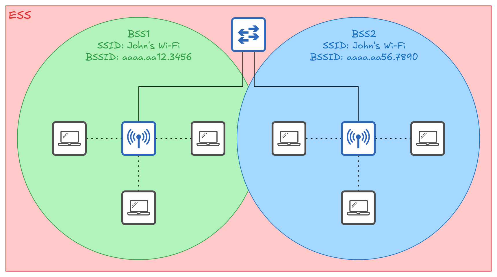
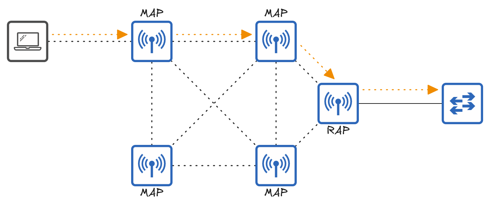

# 1.B Wireless Fundamentals
## Introduction
Wireless LAN standards are defined in IEEE 802.11.
- The term **Wi-Fi** is a trademark of the **Wi-Fi Alliance** and is separate from the IEEE.
- The Wi-Fi Alliance tests and certifies equipment to ensure compliance with 802.11 standards and interoperability with other devices.

Wireless networks present several challenges that must be addressed.
1. All devices within range can receive transmitted frames, similar to devices connected to an Ethernet hub.
	- Data privacy within the LAN is a greater concern.
	- **CSMA/CA (Carrier-Sense Multiple Access with Collision Avoidance)** is used in wireless networks to avoid collisions.
	- When using CSMA/CA, a device waits for the channel to become available before transmitting data.
2. Wireless communications are regulated by various international and national bodies.
	- The 802.11 standard specifies the frequencies available for wireless LANs and devices are designed to operate within those frequency bands.
3. Wireless signal coverage must be considered.
	- **Signal range** determines the area in which wireless communication is possible.
	- **Absorption** occurs when a material converts part of a wireless signal's energy into heat, weakening the signal.
	- **Reflection** occurs when a signal bounces off a surface.
	- **Refraction** occurs when a wave bends as it enters a medium in which it travels at a different speed.
	- **Diffraction** occurs when a wave encounters an obstacle and travels around it.
	- **Scattering** occurs when a material causes a signal to scatter in all directions.
4. Other devices operating on the same channels can cause interference.
## Radio Frequency (RF)
Radio frequencies are the rates at which electromagnetic waves oscillate, measured in **hertz (Hz)**. They are used to transmit information wirelessly, including radio broadcasts, television, mobile phone signals and **Wi-Fi**.
- Wireless signals are generated by applying an alternating current to an antenna.
	- This produces electromagnetic fields that propagate as waves.
- Electromagnetic waves can be characterized in multiple ways, such as **amplitude** and **frequency**.
	- **Amplitude** is the maximum strength of the electric and magnetic fields.
	- Frequency is the number of cycles per unit of time.
	- **Period** is the time required to complete one cycle.
- The **radio frequency spectrum** ranges is from **30 Hz to 300 GHz** and is used for many purposes.
### Wi-Fi Frequency Bands
Wi-Fi frequency bands are **ranges of radio frequencies** that devices use to communicate wirelessly.
- Wi-Fi uses two main bands.
	- **2.4 GHz**
	- **5 GHz**
- The 2.4 GHz band typically provides further reach in open space and better penetration of obstacles such as walls.
- **Wi-Fi 6 (IEEE 802.11ax)** has expanded the spectrum range to include a band in the **6 GHz** range.
### Wi-Fi Channels
A band contains many possible frequencies. Wi-Fi divides portions of these bands into smaller units called **channels**.
- Devices are configured to transmit and receive traffic on one or more channels.
- The 2.4 GHz band is divided into multiple channels, each with a bandwidth of **22 MHz**.
- In a small wireless LAN with a single **access point (AP)**, any available channel can be used. However, in larger WLANs with multiple APs, adjacent APs should use non-overlapping channels to reduce interference.
- In the 2.4 GHz band, **channels 1, 6 and 11** are recommended because they do not overlap.
- The 5 GHz band consists of non-overlapping channels, so it is much easier to avoid interference between adjacent APs.
### IEEE 802.11 Standards
| Standard |   Frequencies   | Max Data Rate (Theoretical) | Altername Name |
| :------: | :-------------: | :-------------------------: | :------------: |
|  802.11  |     2.4 GHz     |           2 Mbps            |       -        |
| 802.11b  |     2.4 GHz     |           11 Mbps           |       -        |
| 802.11a  |      5 GHz      |           54 Mbps           |       -        |
| 802.11g  |     2.4 GHz     |           54 Mbps           |       -        |
| 802.11n  |   2.4 / 5 GHz   |          600 Mbps           |    Wi-Fi 4     |
| 802.11ac |      5 GHz      |          6.93 Gbps          |    Wi-Fi 5     |
| 802.11ax | 2.4 / 5 / 6 GHz |         4x802.11ac          |    Wi-Fi 6     |
## IEEE 802.11 Service Sets
A service set is a group of wireless devices organized to provide wireless network connectivity.
- There are three main types:
	- **Independent**
	- **Infrastructure**
	- **Mesh**
- All devices in a service set share the same **service set identifier (SSID)**.
	- The SSID is a human-readable name which identifies the service set.
	- The SSID does **not** have to be unique.
### IBSS (Independent Basic Service Set)
IBSS is a mode of a wireless network in which wireless devices communicate directly with each other without using a wireless AP.
- It is commonly called an **ad hoc network**.
- It can be used for file transfers, such as AirDrop.
- It does not scale well beyond a few devices.
### BSS (Basic Service Set)
BSS is a **kind of infrastructure service set** in which devices communicate with each other using a wireless AP, but not directly to each other.
- A **BSSID (Basic Service Set ID)** is used to uniquely identify the AP.
	- Multiple APs can use the same SSID, but not the same BSSID.
	- The BSSID is the MAC address of the AP's radio.
- Wireless devices request to associate with the BSS.
	- Devices associated with the BSS are called **clients** or **stations**.
- The area around an AP where its signal is usable is called a **BSA (Basic Service Area)**.
- Devices **must** communicate through the AP rather than directly with each other.
### ESS (Extended Service Set)
ESS is a wireless network structure consisting of two or more interconnected infrastructure BSSs that form a single wireless network.
- It is a **kind of infrastructure service set**.
- It allows devices to connect across a larger area using multiple access points while appearing to be part of the same logical network.
- APs with their own BSSs are connected by a wired network.
	- Each BSS uses the same SSID.
	- Each BSS has a unique BSSID.
	- Each BSS uses a different channel to avoid interference.
- Devices can pass between APs without having to reconnect, providing a seamless Wi-Fi experience when moving between APs.
	- This is called **roaming**.
	- The BSAs should overlap about 10-15%.

### MBSS (Mesh Basic Service Set)
MBSS is a wireless network structure in which mesh devices communicate with one another to form a mesh network.
- It can be used in situations where it’s difficult to run an Ethernet connection to every AP.
- Mesh APs use two radios: one to provide a BSS to wireless clients, and one to form a **backhaul network** which is used to bridge traffic from AP to AP.
- At least one AP is connected to the wired network, and it is called the **root access point (RAP)**.
- The other APs are called **mesh access points (MAPs)**.
- A protocol is used to determine the best path through the mesh.

### Distribution System (DS)
DS is a system in wireless networking that connects multiple APs and enables communication between different BSSs. It helps transfer data between wireless network cells and can connect them to a larger network, such as a wired LAN.
- Most wireless networks are not standalone networks. Instead, they provide wireless devices with access to the wired network infrastructure.
- In IEEE 802.11, the upstream wired network is called the **distribution system**.
- Each wireless BSS or ESS is mapped to a VLAN in the wired network.
- An AP can provide multiple wireless LANs, each with a unique SSID.
	- Each WLAN is mapped to a separate VLAN and connected to the wired network through a trunk.
	- Each WLAN uses a unique BSSID, typically by incrementing the last digit of the BSSID by one.

### Additional AP Operational Modes
An AP in **repeater** mode can be used to extend the range of a BSS.
- The repeater retransmits signals received from the AP.
	- A repeater with a single radio must operate on the same channel as the AP, which can significantly reduce overall throughput.
	- A repeater with two radios can receive signals on one channel and retransmit them on another.

A **workgroup bridge (WGB)** operates as a wireless client of another AP and can connect wired devices to the wireless network.
- **Universal WGB (UWGB)** is a standard that allows one device to be bridged to the wireless network.
- **WGB** is a Cisco proprietary implementation that allows multiple wired clients to be bridged to the wireless network.

An **outdoor bridge** can be used to connect networks over long distances without a physical cable connecting them.
- The APs will use specialized antennas that focus most of the signal power in one direction, which allows the wireless connection to be made over longer distances than normally possible.
- The connection can be point-to-point or point-to-multipoint in which multiple sites connect to one central site.

