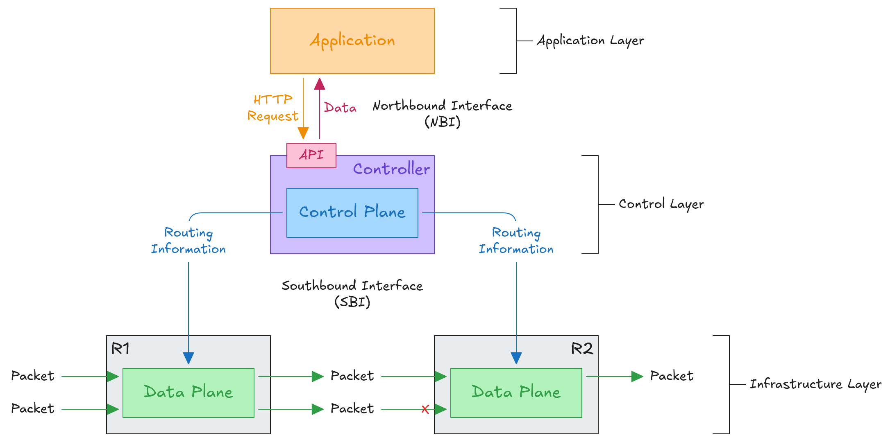
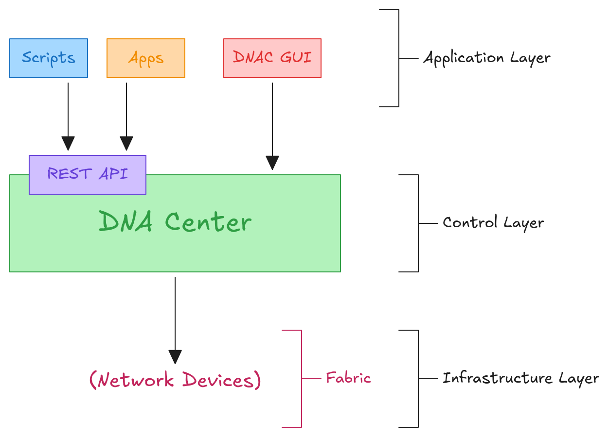

# 6.1 Network Automation
## Introduction
Network automation provides several key benefits:
- Human errors are reduced.
- Networks become more scalable. New deployments, network-wide changes and troubleshooting can be completed in a fraction of the time.
- Network-wide policy compliance can be ensured through standardized configurations, software versions and other policies.
- More efficient network operations reduce operating expenses because each task requires fewer staff hours.
## Logical Planes
Logical planes are conceptual divisions of a network device's functions based on what each function does. They separate tasks such as controlling traffic, forwarding packets and managing the device.
### Data Plane
The data plane is responsible for forwarding packets from input interfaces to the appropriate output interfaces based on forwarding rules.
- All tasks involved in forwarding user data or traffic from one interface to another are part of the data plane.
- A router receives a packet, looks for the most specific matching route in its routing table, and forwards it through the appropriate interface to the next hop.
	- It also removes the original Layer 2 header and adds a new header containing the next hop’s MAC address.
- A switch receives a frame, examines the destination MAC address, and forwards it through the appropriate interface.
	- This includes functions such as adding or removing IEEE 802.1Q VLAN tags.
- NAT is part of the data plane.
- Decisions to forward or discard traffic based on ACLs, port security and other rules are part of the data plane.
- The data plane is also called the **forwarding plane**.
#### ASIC (Application-Specific Integrated Circuit)
An ASIC is an integrated circuit designed to perform a specific task or a limited set of tasks, rather than being a general-purpose processor that can perform many different types of operations.
- The management plane and control plane operations are usually handled by the **CPU**.
	- However, using the CPU for data plane operations is not desirable because CPU processing is relatively slow.
- An ASIC is used for data plane operations to maximize processing speed.
- Using a switch as an example:
	- When a frame is received, the ASIC performs the switching logic.
	- The MAC address table is stored in a type of memory called **TCAM (Ternary Content-Addressable Memory)**.
	- The ASIC uses the frame’s destination MAC address to search the TCAM, which returns the matching MAC address table entry.
	- The frame is then forwarded through the appropriate interface.
- Modern routers also use a similar hardware-based data plane, with an ASIC designed for forwarding operations and tables stored in TCAM.
### Control Plane
The control plane is responsible for making decisions about how network traffic should be routed and for maintaining routing and forwarding information.
- How does a device’s data plane make forwarding decisions?
	- It uses information from the routing table, MAC address table, ARP table, STP and other sources.
- Functions that build these tables and perform other tasks that influence the data plane are part of the control plane.
- The control plane controls the data plane’s behavior, for example, by building the router’s routing table.
- The control plane performs the **overhead work** required to support data forwarding.
	- OSPF does not forward user data packets. It informs the data plane about how packets should be forwarded.
	- STP does not directly forward frames. It determines which interfaces can be used to forward frames.
	- ARP messages are not user data, but they are used to build the ARP table, which supports the process of forwarding data.
- In traditional networking, both the data plane and the control plane are distributed. Each device has its own data plane and control plane, with both planes distributed throughout the network.
### Management Plane
The management plane is responsible for configuring, monitoring and troubleshooting network devices through administrative interfaces and management protocols.
- Like the control plane, the management plane performs overhead tasks. However, it does not directly affect message forwarding in the data plane.
- The management plane includes protocols used to manage network devices:
	- SSH/Telnet is used to access a device’s CLI for configuration and management.
	- Syslog is used to record events that occur on the device.
	- SNMP is used to monitor the device’s operations.
	- NTP is used to maintain accurate time on the device.

## SDN (Software-Defined Networking)
SDN is a networking architecture that separates the network's control plane from its data plane, allowing network administrators to manage network behavior through software rather than configuring each device individually.
- SDN centralizes the control plane into an application called a **controller**.
- SDN is also called **software-defined architecture (SDA)** or **controller-based networking**.
- The controller can interact programmatically with the network devices using **APIs (Application Programming Interface)**.
### SDN Layers
**Application Layer**: Contains network applications and services that communicate their requirements to the SDN controller through APIs.
- Defines network policies and requirements.
- Monitors network performance and security.
- Requests traffic management, load balancing and access control.

**Control Layer**: Contains the SDN controller, which makes decisions about how network traffic should be managed and forwarded.
- Maintains a logical view of the network.
- Translates application policies into forwarding rules.
- Programs network devices and coordinates traffic paths.

**Infrastructure Layer**: Contains physical or virtual network devices that forward packets according to rules supplied by the control layer.
- Forwards packets to their destinations.
- Applies forwarding, filtering and traffic-handling rules.
- Reports network status to the controller.

### SBI (Southbound Interface)
The SBI is the interface through which an SDN controller communicates with network devices, such as switches and routers, to control their behavior.
- It typically consists of a communication protocol and an API.
- APIs facilitate data exchange between programs.
	- Data is exchanged between the controller and network devices.
	- An API on a network device allows the controller to access device information, manage data plane tables and perform other operations.
- Using the SBI, the controller communicates with managed devices and gathers information about them, including:
	- The devices in the network.
	- The network topology (how the devices are connected).
	- The available interfaces on each device.
	- The configurations of each device.
- Examples of SBIs include OpenFlow, Cisco OpFlex, Cisco onePK and NETCONF.
### NBI (Northbound Interface)
The NBI is the interface through which SDN applications communicate with the SDN controller to request network services, define policies and obtain network information.
- A **REST API** is used on the controller as an interface for apps to interact with it.
	- REST stands for **representational state transfer**.
- Data is sent in a **structured (serialized)** format such as JSON or XML.
	- This makes it much easier for programs to use the data.
### Automation in Traditional Networks vs SDN
- Networking tasks can be automated in traditional networks.
	- Scripts can be written (e.g., using Python) to push commands to multiple devices at once.
	- Python with good use of regular expressions can parse the output of show commands to gather information about network devices.
- However, the robust and centralized data collected by SDN controllers greatly facilitates these tasks.
	- The controller collects information about all devices in the network.
	- Northbound APIs allow applications to access information in a format that is easy for programs to process.
	- Centralized data facilitates network-wide analytics.
- SDN tools can provide the benefits of automation without requiring third-party scripts or applications.
	- No automation expertise is required to use SDN tools.
	- However, APIs allow third-party applications to interact with the controller, providing powerful additional capabilities.
## SD-Access (Software-Defined Access)
SD-Access is Cisco’s SDN solution for automating, securing and managing enterprise campus networks.
- Cisco has other SDN solutions:
	- **ACI (Application Centric Infrastructure)** is their SDN solution for automating data center networks.
	- **SD-WAN** is their SDN solution for automating WANs.
- Cisco **DNA (Digital Network Architecture) Center** is the controller at the center of SD-Access.
- The **fabric** is the combination of the overlay and underlay.

### SD-Access Underlay
The underlay is the underlying physical network of devices and connections, including wired and wireless connections, that provides IP connectivity (e.g., using IS-IS).
- The underlay's purpose is to support the VXLAN tunnels used by the overlay.
- There are three different roles for switches in SD-Access:
	- **Edge Nodes**: Connect to the end hosts.
	- **Border Nodes**: Connect to devices outside the SD-Access domain, such as WAN routers.
	- **Control Nodes**: Use **LISP (Locator/ID Separation Protocol)** to perform various control plane functions.
- SD-Access can be deployed on top of an existing network (a **brownfield deployment**) if the network hardware and software support it.
	- In this case, DNA Center won't configure the underlay.
- A new deployment (a **greenfield deployment**) will be configured by DNA Center to use the optimal SD-Access underlay:
	- All switches operate at Layer 3 and use IS-IS as their routing protocol.
	- All links between switches are routed ports, so STP is not needed.
	- Edge nodes (access switches) act as the default gateways for end hosts (routed access layer).

### SD-Access Overlay
The overlay is a logical network built over the underlay using tunneling and endpoint-mapping technologies to provide connectivity and segmentation independent of the physical topology.
- LISP provides the control plane for SD-Access.
	- A list of mappings between **EIDs (Endpoint Identifiers)** and **RLOCs (Routing Locators)** is kept.
	- EIDs identify end hosts connected to edge switches, while RLOCs identify the edge switches that can be used to reach those end hosts.
- **VXLAN (Virtual Extensible LAN)** provides the data plane for SD-Access.
- **Cisco TrustSec (CTS)** provides policy control, including QoS and security policies.

## Cisco DNA Center
Cisco DNA Center is a centralized network management and automation platform developed by Cisco for managing enterprise networks.
- DNA Center has two main roles:
	- An SDN controller in SD-Access.
	- A network manager in a traditional network (non-SD-Access).
- DNA Center is an application that runs on Cisco UCS (Unified Computing System) server hardware.
- It provides a REST API that can be used to interact with DNA Center.
- The SBI supports protocols such as NETCONF and RESTCONF, as well as traditional protocols such as Telnet, SSH and SNMP.
- DNA Center enables **intent-based networking (IBN)**.
	- The goal is to allow network engineers to communicate their intent for network behavior to DNA Center, which then handles the details of configuring devices and applying policies.
	- This is essentially a **declarative** approach.
### DNA Center vs Traditional Network Management
|       Feature       |                                  Traditional                                  |                                         DNA Center                                         |
| :-----------------: | :---------------------------------------------------------------------------: | :----------------------------------------------------------------------------------------: |
|    Configuration    |            Devices are configured individually via SSH or console.            |             Configurations are managed centrally through the GUI or REST API.              |
|     Deployment      | Devices are manually configured before deployment, making the process slower. |       New devices can automatically receive configurations, speeding up deployment.        |
|  Policy Management  |          Policies are configured and managed on individual devices.           |           Policies are centrally managed based on the intended network behavior.           |
| Software Management |            Software versions are managed and updated individually.            | Software versions are centrally managed and updates can be coordinated through DNA Center. |
|     Error Rate      |              Manual configuration increases the risk of errors.               |                 Automation reduces manual effort and configuration errors.                 |
