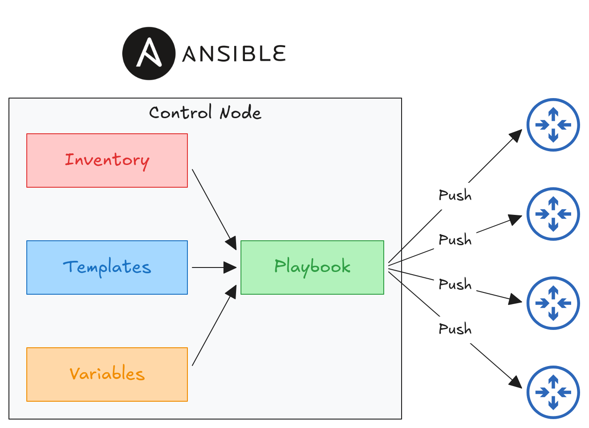
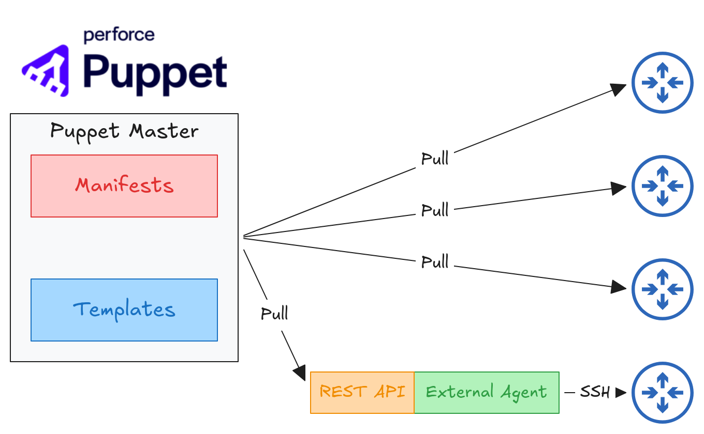

# 6.5 Ansible, Puppet and Chef
## Introduction
**Configuration drift** occurs when individual changes made over time cause a device’s configuration to deviate from the standard configurations defined by the company.
- Although each device has unique parts of its configuration, most of its configuration is usually based on standard templates designed by the company’s network engineers.
- As individual engineers make changes to devices, a device’s configuration can drift away from the standard.
- Records of these individual changes and the reasons for them may not be maintained, which can lead to future issues.

**Configuration provisioning** refers to how configuration changes are applied to devices.

**Configuration management tools** allow changes to multiple devices to be made at scale with a fraction of the time and effort.
- These tools were originally developed after the rise of VMs, to enable server system admins to automate the process of creating, configuring and removing VMs.
	- However, they are also widely used to manage network devices.
- These tools can be used to perform tasks such as:
	- Generate configurations for new devices on a large scale.
	- Perform configuration changes on devices.
	- Check device configurations for compliance with defined standards.
	- Compare configurations between devices and between different versions of configurations on the same device.
- Two essential components of these tools are **templates** and **variables**.

## Ansible
Ansible is an open-source IT automation tool used to configure servers, deploy applications, manage infrastructure and automate repetitive system administration tasks.
- It is owned by **Red Hat**.
- Ansible itself is written in **Python**.
- Ansible is **agentless**.
	- It doesn't require any special software to be installed on managed devices.
	- It uses SSH to connect to devices, make configuration changes, retrieve information, etc.
- Ansible uses a **push model**. The Ansible control node uses SSH to connect to managed devices and push configuration changes to them.
- After installing Ansible, several text files must be created:
	- **Playbooks**: These files serve as blueprints for automation tasks. They outline the logic and actions that Ansible should perform. They are written in YAML.
	- **Inventory**: These files list the devices managed by Ansible, as well as characteristics of each device, such as its role. They can be written in INI, YAML or other formats.
	- **Templates**: : These files represent device configuration files, but specific values for variables are not provided. They are written using the Jinja2 templating language.
	- **Variables**: These files list variables and their values. The values are substituted into templates to generate complete configuration files. They are commonly defined in YAML files.

## Puppet
Puppet is an open-source configuration management tool used to automate the installation, configuration and maintenance of servers.
- Puppet itself is written in **Ruby**.
- Puppet is typically **agent-based**.
	- Specific software must be installed on the managed devices.
	- Not all Cisco devices support a Puppet agent.
- Puppet **can also be run in agentless mode**, in which a proxy agent runs on an external host and uses SSH to connect to and communicate with the managed devices.
- The Puppet server is called the **Puppet master**.
- Puppet uses a **pull model**, in which clients pull configurations from the Puppet master.
	- Clients use **TCP port 8140** to communicate with the Puppet master.
- Instead of YAML, Puppet uses a proprietary language to define configurations.
- The text files required on the Puppet master include:
	- **Manifest**: Defines the desired configuration state of a managed device.
	- **Templates**: Similar to Ansible templates. They are used to generate manifests.

## Chef
Chef is an infrastructure automation and configuration management tool used to automate the installation, configuration and maintenance of servers.
- Chef itself is written in **Ruby**.
- Chef is **agent-based**.
	- Specific software must be installed on the managed devices.
	- Not all Cisco devices support a Chef agent.
- Chef uses a **pull model**, in which clients pull configurations from the Chef server.
	- Clients use **TCP port 10002** to communicate with the Chef server.
- Chef uses a **DSL (Domain-Specific Language)** based on Ruby to define configurations.
- The text files and components used by Chef include:
	- **Resources**: The "ingredients" in a recipe. They represent configuration objects managed by Chef.
	- **Recipes**: The "recipes" in a cookbook. They outline the logic and actions used to manage resources.
	- **Cookbooks**: Collections of related recipes grouped together.
	- **Run-list**: An ordered list of recipes that are executed to bring a device to the desired configuration state.
## Comparison
|          Feature           |  Ansible  |          Puppet           |       Chef       |
| :------------------------: | :-------: | :-----------------------: | :--------------: |
| Key Files Defining Actions | Playbook  |         Manifest          | Recipe, Run-list |
|   Communication Protocol   |    SSH    |           HTTPS           |      HTTPS       |
|          Key Port          |  TCP 22   |         TCP 8140          |    TCP 10002     |
|     Agent Architecture     | Agentless | Agent-based or Agentless* |   Agent-based    |
|      Execution Model       |   Push    |           Pull            |       Pull       |
>\*: Puppet can support agentless management in certain configurations, but its standard model uses an agent.