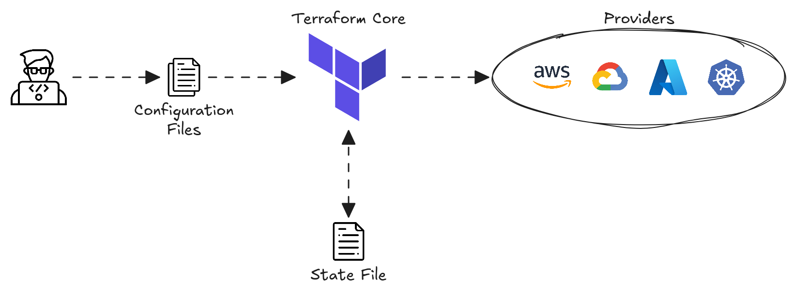

# 6.6 Terraform
## Introduction
**Infrastructure as code (laC)** is the practice of provisioning and managing infrastructure using machine-readable configuration files instead of manual configuration.
- Ansible, Puppet and Chef are examples of laC configuration management tools.

Terraform is an laC-based **provisioning tool** that automates the creation of infrastructure resources.
## Provisioning and Management
Configuration management tools work on **existing systems**, whereas provisioning tools **build infrastructure**
**from scratch**.

**Configuration Management** (e.g., Ansible, Puppet, Chef)
- Manages existing infrastructure by installing software, configuring settings and maintaining system state.
- Ensures consistency by applying and enforcing configurations across multiple devices.

**Infrastructure Provisioning** (e.g., Terraform)
- Creates, modifies and deletes infrastructure resources, such as servers and network infrastructure.
- Focuses on creating and managing infrastructure resources rather than ongoing configuration management.

## Mutable and Immutable Infrastructure
Configuration management tools typically use a **mutable infrastructure** approach.
- Infrastructure can be modified after deployment.
- Changes are made in place, meaning existing resources are updated rather than replaced.

Provisioning tools often employ an **immutable infrastructure** approach.
- Infrastructure resources are not modified after deployment.
- Changes involve replacing existing resources with new versions.
- This approach reduces configuration drift because each replacement starts from a fresh, predefined state.
## Procedural and Declerative Approach
**Procedural Approach (a.k.a. Imperative Approach)**:
- Follows explicit steps in a specific order to achieve the desired outcome.
- Each action required to configure the infrastructure must be explicitly defined.
- Provides greater control compared to a declarative approach.
- Focuses on **how** to make changes by specifying the steps to follow.
- **Ansible** and **Chef** are procedural tools.

**Declarative Approach**:
- Defines the desired end state.
- The tool determines the steps needed to achieve the desired state.
- Is easier to maintain and helps ensure consistency across deployments.
- Focuses on **what** the final state should be.
- **Terraform** and **Puppet** are declarative tools.
## Terraform
Terraform is an open-source infrastructure as code (IaC) tool that enables infrastructure to be created, configured and managed using code instead of manually configuring resources.
- It is developed by **HashiCorp**.
- It is primarily a **provisioning tool** focused on deploying infrastructure resources across various cloud and on-premises platforms.
	- These platforms are called **providers** and include AWS, GCP, Azure, Kubernetes and many others.
	- Terraform also integrates with Cisco platforms such as **Catalyst Center**, **ACI** and **IOS XE**.
- Terraform is written in **Go**, while its configuration files are written in **HashiCorp Configuration Language (HCL)**.
	- HCL is an example of a domain-specific language (DSL), a type of language specialized for a particular purpose.
- Terraform maintains a **state file** that tracks managed infrastructure resources and their attributes.
- Terraform uses a **push model** and is **agentless**. It doesn’t require a software agent on infrastructure it provisions or manages.
- The basic Terraform workflow consists of three main steps:
	- **Write**: Define the desired state of infrastructure resources in configuration files.
	- **Plan**: Review the changes that will be made before applying them.
	- **Apply**: Execute the plan to provision and manage infrastructure resources.

